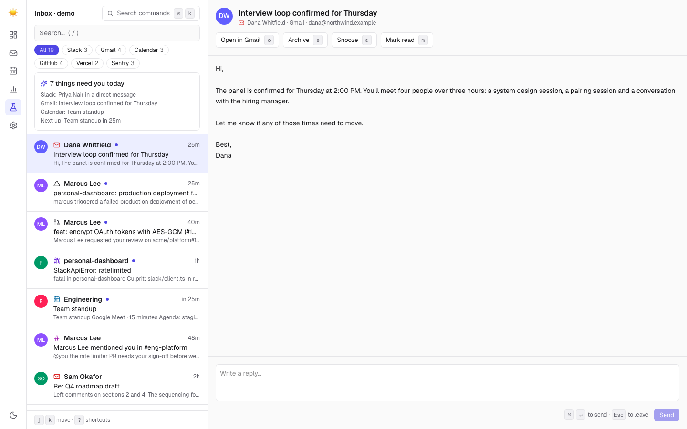
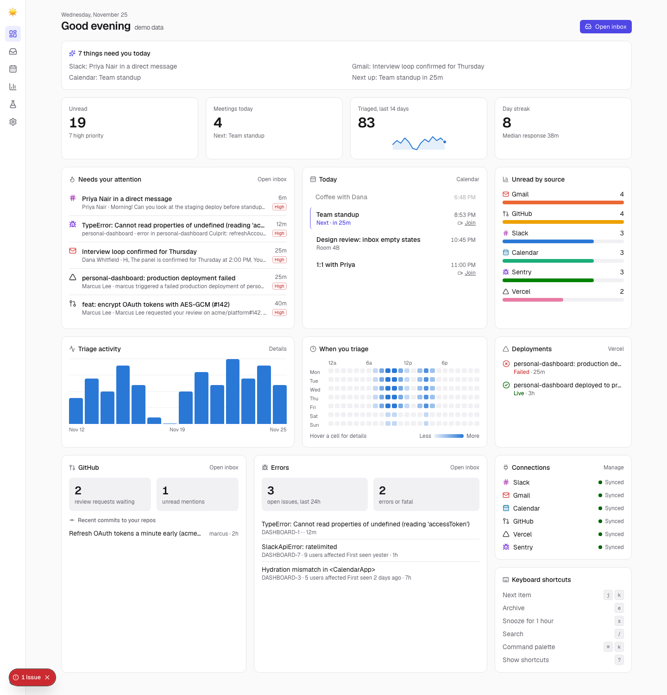
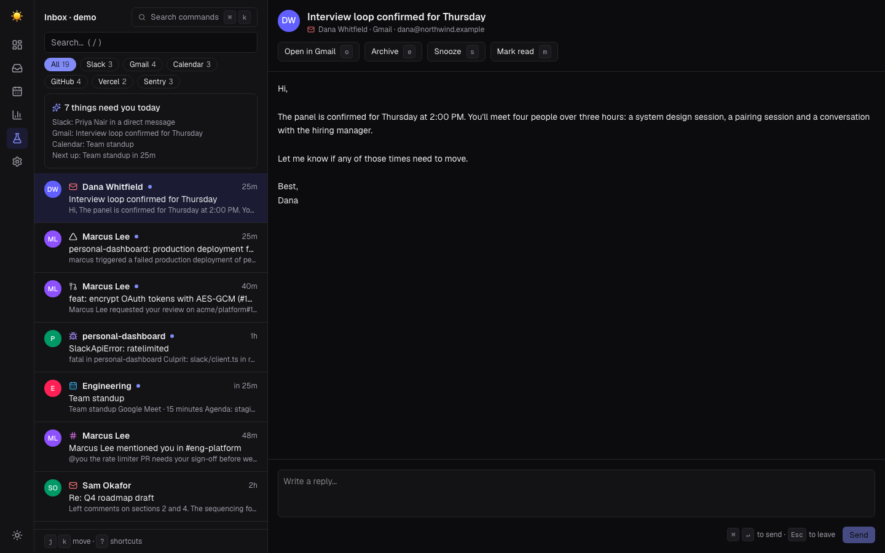
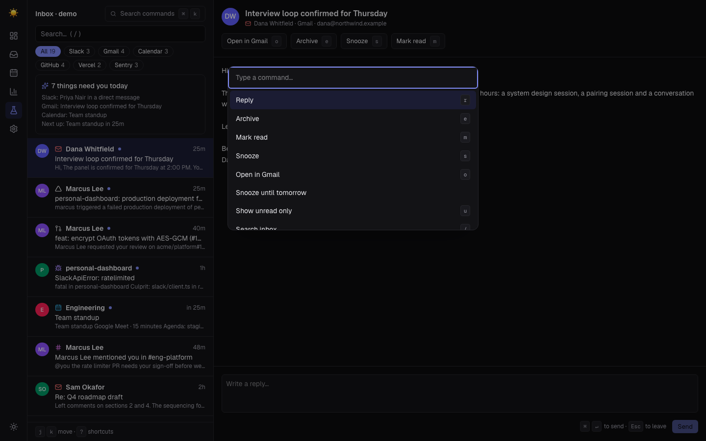
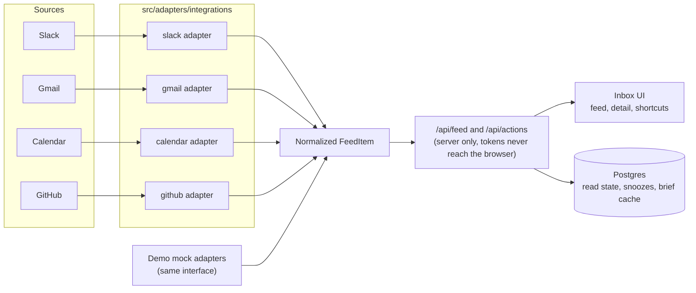

# ☀️ Morning

**One keyboard-first inbox for Slack, Gmail, Google Calendar, GitHub, Vercel and Sentry.** Triage everything that needs you without switching apps, then get on with your day.

### 👉 [Try the demo](https://personal-dashboard-cyan-ten.vercel.app/demo) &nbsp;·&nbsp; no sign-up, loads in seconds



<details>
<summary>Dashboard, dark mode and command palette</summary>






</details>

## What it does

- **Unified feed:** Slack DMs and mentions, unread Gmail threads, today's calendar events and GitHub review requests, mentions and commits pushed to your own repos (your own commits arrive already read), sorted by priority then time, with source filter chips.
- **Split view:** the feed on the left, the full message or email on the right, with a link out to the source.
- **Inline actions with optimistic updates:** reply, archive, mark read, snooze and open. A failed action rolls back with a toast.
- **Daily brief:** a short summary of what needs you. Rule-based by default; add an `ANTHROPIC_API_KEY` and Claude writes it once per morning instead (cached).
- **Live updates:** per-source polling, plus a signed Slack Events webhook. New items slide in.
- **Demo mode:** the whole app on seeded data, through the same adapter interface, with no OAuth.
- **Dashboard (`/dashboard`):** one screen of widgets over the same data: what needs you, today's agenda, unread by source, a 14-day triage chart, a weekday-by-hour activity heatmap, GitHub review queue and recent commits, Vercel deployments and connection health. Demo data when signed out.
- **Calendar page:** a week view of your Google Calendar where you can add events (guests, location, Meet link) without opening Google Calendar. Signed-out visitors get an in-memory demo.
- **Search and stats:** `/` searches title, preview and sender; `/stats` shows what you triaged, your median response time and a day streak.
- **Background sync and push:** a scheduled workflow syncs every 10 minutes and sends a Web Push notification for new high-priority items (opt in under Settings).
- **Keyboard-first:** every action has a shortcut, and `⌘K` opens a command palette.

## Keyboard shortcuts

| Key             | Action                                           |
| --------------- | ------------------------------------------------ |
| `j` / `k`       | Next / previous item                             |
| `Enter`         | Open detail (and mark read)                      |
| `e`             | Archive (Dismiss on events, Mark done on GitHub) |
| `r`             | Reply                                            |
| `s`             | Snooze for 1 hour                                |
| `m`             | Mark as read                                     |
| `o`             | Open in the source app                           |
| `/`             | Search the inbox (`Esc` clears)                  |
| `u`             | Show unread only                                 |
| `⌘K` / `Ctrl+K` | Command palette                                  |
| `?`             | Shortcut cheatsheet                              |

The shortcuts are defined once in `src/features/shortcuts/shortcuts.ts`; the handlers, button hints, palette and cheatsheet all read from that map.

## Architecture



Every vendor API shape is converted to one `FeedItem` inside its adapter; the UI never sees a raw payload. Each adapter has a normalizer with unit tests. Demo mode swaps the real adapters for in-memory ones that implement the same `IntegrationAdapter` interface.

Stack: Next.js 16 (App Router, React 19), TypeScript strict, Tailwind v4, Prisma on Neon Postgres, Auth.js, Anthropic API, Sentry, PostHog, Vitest, Playwright, Vercel.

## Adding a new integration in one file

1. Create `src/adapters/integrations/<source>/` with an `IntegrationAdapter` (`fetchItems`, `performAction`) and a normalizer that returns `FeedItem`s. Add an `OAuthProvider` if it uses OAuth.
2. Add the source to the `Source` enum in `prisma/schema.prisma` and its label, icon and accent to `SOURCE_CONFIG` in `src/features/feed/sources.ts`.
3. Add one line to each map in `src/adapters/integrations/registry.ts`.

The API routes, settings page, sync, failure banner and OAuth callback all read from those maps.

## Run it locally

```bash
pnpm install
cp .env.example .env.local     # then fill in what you need
docker compose up -d           # local Postgres
pnpm prisma migrate dev        # applies migrations, generates the client
pnpm dev                       # http://localhost:3000
```

The **demo works with no environment variables beyond `DATABASE_URL`**: open `/demo`. Live accounts need the variables below.

| Variable                                                         | Used for                                                                    |
| ---------------------------------------------------------------- | --------------------------------------------------------------------------- |
| `DATABASE_URL`, `DIRECT_URL`                                     | Postgres (pooled, and direct for migrations)                                |
| `AUTH_SECRET`, `AUTH_GITHUB_ID`, `AUTH_GITHUB_SECRET`            | App sign-in (Auth.js, GitHub)                                               |
| `APP_URL`                                                        | Public origin for OAuth redirects (use a tunnel locally; Slack needs https) |
| `TOKEN_ENCRYPTION_KEY`                                           | Encrypts stored OAuth tokens (`openssl rand -base64 32`)                    |
| `SLACK_CLIENT_ID`, `SLACK_CLIENT_SECRET`, `SLACK_SIGNING_SECRET` | Slack                                                                       |
| `GOOGLE_CLIENT_ID`, `GOOGLE_CLIENT_SECRET`                       | Gmail and Calendar                                                          |
| `GITHUB_CLIENT_ID`, `GITHUB_CLIENT_SECRET`                       | GitHub integration (a separate OAuth app from sign-in)                      |
| `ANTHROPIC_API_KEY`, `BRIEF_MODEL` (optional)                    | Daily brief                                                                 |
| `SENTRY_DSN`, `NEXT_PUBLIC_SENTRY_DSN`, `SENTRY_AUTH_TOKEN`      | Error monitoring                                                            |
| `NEXT_PUBLIC_POSTHOG_KEY`, `NEXT_PUBLIC_POSTHOG_HOST`            | Product analytics                                                           |

All of them are listed in [`.env.example`](.env.example) with no values. Never commit real tokens.

Checks before a PR: `pnpm lint && pnpm tsc --noEmit && pnpm test && pnpm build`. End-to-end: `pnpm test:e2e` (set `E2E_BASE_URL` to run against a preview). Screenshots: `pnpm screenshots`.

## Connecting accounts

### Slack

Create a Slack app. Under OAuth, add the redirect URL `<APP_URL>/api/integrations/slack/callback` and these **user** scopes: `search:read`, `im:history`, `im:read`, `im:write`, `channels:history`, `channels:write`, `users:read`, `chat:write`. For push updates, enable Event Subscriptions with the request URL `<APP_URL>/api/webhooks/slack` and the user events `message.im` and `message.channels`.

### Gmail and Calendar

One Google sign-in connects both. In Google Cloud, create a Web OAuth client with the redirect URI `<APP_URL>/api/integrations/gmail/callback` and enable the Gmail and Google Calendar APIs. Scopes: `gmail.modify` (read, archive, mark read), `gmail.send` (replies) and `calendar.events` (read your events and add new ones from the Calendar page; accounts connected before that scope was added must reconnect once).

**Why Gmail runs in testing mode.** Gmail's modify and send scopes are _restricted_: publishing an app that uses them requires Google's app verification and a third-party security assessment. This project keeps the OAuth consent screen in **Testing** with the owner as a test user, which also means Google expires refresh tokens after 7 days (reconnect weekly). Everyone else uses the demo, which covers the same interface.

Calendar shows timed, non-declined events from 2 hours ago to 24 hours ahead and is read-only; snooze and dismiss are local.

### Vercel

Deployments are read with a personal access token instead of OAuth (Vercel has no OAuth flow for reading your own deployments). Create one at https://vercel.com/account/tokens, scoped to the teams you want to watch, and paste it under Settings → Vercel. It is checked, then stored encrypted. Failed deployments arrive as unread items (high priority when they are production, which also triggers a push notification); successful production deploys arrive already read. Archiving and snoozing only affect this app.

### Sentry

Read-only, connected with a token. Create one at https://sentry.io/settings/account/api/auth-tokens/ with the scopes `org:read`, `project:read` and `event:read`, then enter it in Settings with your organization slug (the first part of your Sentry URL) and region (US or EU). The inbox shows every unresolved issue seen in the last 24 hours: errors and fatals are high priority (new ones also send a push notification), warnings normal. Event counts are refreshed on each sync. Under Settings you can pick which projects to watch; all of them are watched until you narrow it down. Archive and snooze only affect this app, so nothing is ever resolved in Sentry from here.

### GitHub

Create a GitHub **OAuth App** with the callback `<APP_URL>/api/integrations/github/callback`. Scopes: `notifications` (review requests and mentions) and `repo` (the one broad scope: GitHub only allows reading private pull requests with it). "Mark done" removes the notification on GitHub. Commits come from your 15 most recently pushed repos (about 17 API calls per sync). GitHub has no push for OAuth apps, so it syncs by polling.

## Daily brief

Written by Claude (`src/adapters/ai.ts`, default model `claude-opus-5-5`) from your unread items, server-side only, once per user per local day, cached in the `DailyBrief` table. The prompt contains titles, sender names, short previews and meeting times, never full bodies or links, and inbox content is fenced and treated as untrusted. Output is constrained to a JSON schema and validated. Without an API key, with an empty inbox, or on any model error or refusal, the card falls back to a rule-based brief (uncached). Demo mode always uses the rule-based brief, so visitors cannot spend your API budget.

## Security notes

- **Tokens are encrypted at rest** with AES-256-GCM (`src/lib/crypto.ts`); the key lives only in the environment. Vendor tokens never reach the browser: the UI calls `/api/feed` and `/api/actions`, which run the adapters on the server.
- **Webhooks are verified:** Slack requests are checked against the signing secret (HMAC, 5-minute replay window) before anything is parsed.
- **Least-privilege scopes**, listed above with the reason for each. `repo` is the single broad one.
- OAuth flows use a random `state` in an httpOnly cookie, and Google refresh tokens are used transparently when access tokens expire.
- State-changing routes reject cross-site requests (Origin and `Sec-Fetch-Site`) on top of SameSite cookies. Standard security headers are set; a strict CSP is not yet.
- Sentry events are scrubbed of OAuth `code`/`state`, cookies and credential headers.
- AI input is minimized and fenced; AI output is schema-validated.

## Failure handling

Each source syncs independently, so one failing integration never blanks the inbox. A banner names the source and the reason: **reconnect needed** (revoked or expired token), **rate limited** (honoring `Retry-After`; GitHub's hourly quota fails fast), or a plain failure retried on the next sync. If every source fails on first load, a retry screen replaces the misleading "Inbox zero". Adapters back off on rate limits and paginate internally, never in the UI.

## Tests

`pnpm test` runs 130+ unit tests: every adapter's normalizer and actions, OAuth, signature verification, encryption, caching, failure classification and the feed logic. `pnpm test:e2e` runs the Playwright suite against demo mode (filters, `j`/`k`/`e`/`r`/`s`, palette, cheatsheet, dark mode, live arrival of new items).

## Deploy

1. Create a Vercel project from the GitHub repo, or use `terraform/` (Vercel provider) to create the project, domain and environment variables.
2. Add a Neon database through the Vercel Marketplace and set `DATABASE_URL` (pooled) and `DIRECT_URL`.
3. Set the remaining environment variables for the integrations you want. Run `pnpm prisma migrate deploy` against the production database.
4. Set `APP_URL` to the production URL and register it in each provider's redirect and webhook settings.
5. Run the e2e suite against the preview: `E2E_BASE_URL=https://<preview>.vercel.app pnpm test:e2e`.

## Monitoring and analytics

**Sentry** (`src/adapters/monitoring.ts`): set the three `SENTRY_*` variables in Vercel. It is off outside production. To check it, call `captureError(new Error("test"))` in a production build and look for it in Sentry.

**PostHog** (`src/adapters/analytics.ts`): set the two `NEXT_PUBLIC_POSTHOG_*` variables. Tracking is off outside production and carries no personal data. Events live in `src/adapters/analytics-events.ts`: `demo_started`, `inbox_opened`, `item_action_performed` (action and source only) and `command_palette_opened`. To check it, open `/demo` in a production build and watch PostHog's Live events.

## Folder map

```
src/app/            thin routes: landing, /demo, /inbox, /settings, API routes
src/features/       feed, detail, brief, shortcuts, demo, settings, inbox
src/adapters/       the only place vendor SDKs and APIs are touched
  integrations/     slack, gmail, calendar, github, google (shared), registry
src/components/ui/  presentational primitives
prisma/schema.prisma  the contract; every change is a migration
terraform/          Vercel project, env vars, domain
```
